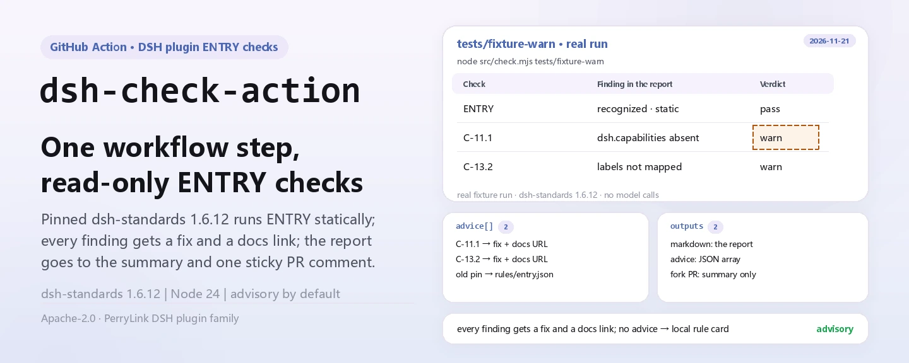
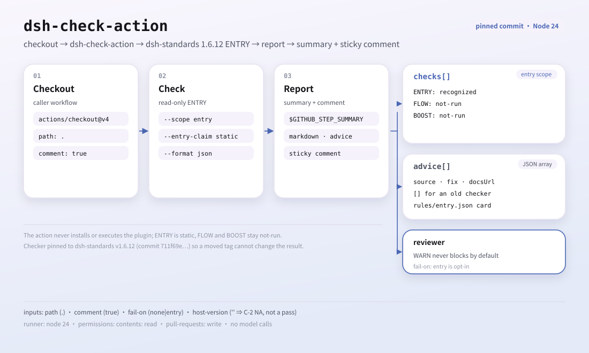
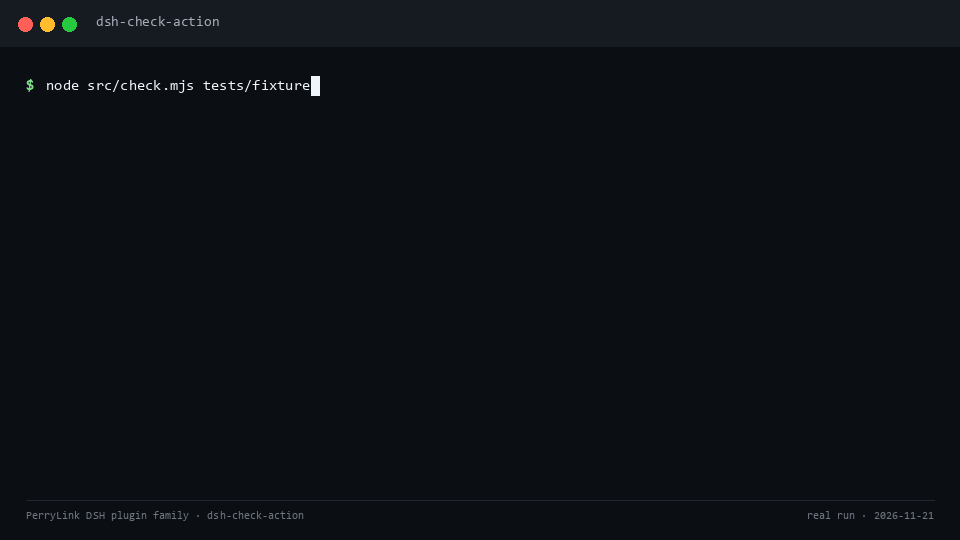

<div align="center">

<picture>
  <source media="(prefers-color-scheme: dark)" srcset="docs/assets/dsh-check-action-hero-en-dark.webp">
  
</picture>

# dsh-check-action

**Comprobaciones ENTRY de solo lectura para un plugin de DSH, con sugerencias deterministas — sin llamadas a modelos, así que una ejecución no cuesta tokens.**

*Una composite action alrededor del checker `dsh-standards` fijado: ejecuta ENTRY de forma estática, convierte su `advice[]` en un informe markdown, lo escribe en el job summary y mantiene un único comentario sticky en los PR del mismo repositorio. Los PR de fork reciben solo el resumen.*

[English](README.md) · [简体中文](README-zh.md) · Español · [Português](README-pt.md) · [हिन्दी](README-hi.md)

[](action.yml)
[]()
[](https://github.com/PerryLink/dsh-standards/blob/main/LICENSE)

</div>

---

```yaml
name: DSH check
on: [pull_request]
permissions:
  contents: read
  pull-requests: write
jobs:
  check:
    runs-on: ubuntu-latest
    steps:
      - uses: actions/checkout@v4
      - id: dsh
        uses: PerryLink/dsh-check-action@v1
        with:
          path: .
          comment: true
          fail-on: none   # advisory by default
          # host-version: 0.2.2-rc.3
```

## Qué hace

1. Ejecuta el checker de DSH (`dsh-standards`, fijado a un commit) en modo ENTRY estático.
2. Lee su `advice[]` aditivo (la versión 1.2 y posteriores): una corrección y una URL de guía
   por hallazgo. Si el checker no trae `advice` (un pin antiguo), recurre a las tarjetas
   integradas de `rules/entry.json` — sin error y con la misma salida de asesoramiento.
3. Escribe el informe en el job summary y lo expone como la salida `markdown`.
   Las entradas crudas `advice[]` del checker se exponen como la salida `advice`
   (un arreglo JSON; `[]` cuando el checker fijado no emite advice).
4. En los pull requests del mismo repositorio publica o actualiza un único comentario
   sticky. **Los pull requests de fork reciben solo el job summary**: allí el token es
   de solo lectura, así que el paso de comentario se omite en lugar de fallar.


<picture>
  <source media="(prefers-color-scheme: dark)" srcset="docs/assets/dsh-check-action-flow-v5-dark.svg">
  
</picture>

*Estructura: checkout → check → publish; el checker es ENTRY estático y de solo lectura, así que FLOW y BOOST quedan en `not-run`. Las etiquetas dentro del diagrama son los inputs reales de la action, las flags del checker y los nombres de las salidas, así que la misma imagen sirve para los cinco idiomas.*

## Entradas

| entrada | valor por defecto | significado |
|---|---|---|
| `path` | `.` | Ruta del paquete del plugin dentro del repositorio. |
| `comment` | `true` | Publica o actualiza un comentario sticky del pull request (solo PR del mismo repositorio). |
| `fail-on` | `none` | `none` mantiene la ejecución como asesoramiento; `entry` hace fallar el job ante un fallo ENTRY duro. |
| `host-version` | `''` | Versión opcional de dsh que ejecuta el host, usada para el ancla C-2. Sin valor ⇒ C-2 es NA, no un aprobado. |

### `host-version`

Opcional. Fija la versión de dsh usada para el ancla C-2 (`engines.dsh`).

**Sin valor significa que C-2 no se juzga: eso es NA, no un aprobado.** La action no
instala un host, y un runner alojado por GitHub normalmente no tiene `dsh` en PATH, así que
la sonda de mejor esfuerzo `dsh --version` del checker no encuentra nada y registra `DSC-02`
como `NA` (compatibilidad no juzgada). Por tanto, un rango `engines.dsh` incorrecto **no**
hace fallar la ejecución con la configuración por defecto, y `fail-on: entry` no lo detecta.
Fija `host-version` (o la variable de entorno `DSH_HOST_VERSION`) cuando quieras que se juzgue
la compatibilidad; para la línea actual usa `0.2.2-rc.3` (npm `next`; `latest` sigue siendo `0.2.2-rc.1`).

El checker 1.6.12 fijado tiene `--host-version`. La action sondea el `--help` del checker y reenvía `--host-version` cuando existe; si no, `--runtime-version` (el mismo ancla con un nombre más antiguo). Si el checker no acepta ninguna de las dos flags, la entrada se ignora, se imprime una nota en el log de la action y se aplica la propia sonda de host del checker (o el ancla de reserva).

## Salidas



*Animado: stdout real de `node src/check.mjs` el 2026-11-21 (checker dsh-standards 1.6.12 — la versión fijada en `action.yml`), ejecutado contra los tres fixtures del repositorio: limpio, WARN y con ids de capacidad reservados. El texto del informe lo generan las plantillas chinas del checker y no se ha reescrito.*


| salida | significado |
|---|---|
| `markdown` | El informe markdown renderizado (el mismo texto escrito en el job summary). |
| `advice` | El `advice[]` del checker como arreglo JSON; `[]` cuando el checker fijado es demasiado antiguo para emitir advice. |

## Qué no hace

- **No** instala ni ejecuta tu plugin. Solo ENTRY.
- **No** juzga la compatibilidad de `engines.dsh` salvo que pases `host-version`:
  sin versión de host el ancla C-2 es desconocida y `DSC-02` es `NA`, no un aprobado.
- **No** ejecuta FLOW (journeys) ni BOOST (tarjetas de evidencia); esos quedan en `not-run`.
- **No** es oficial, no es una certificación y no clasifica nada.
- El informe es **asesor**: WARN no falla, y `fail-on: none` (por defecto) nunca bloquea
  una fusión. `fail-on: entry` solo falla ante un fallo ENTRY duro.

## Fijación de versión

El checker se descarga de `PerryLink/dsh-standards` en un commit fijado
(`DSH_CHECKER_REF` en `action.yml`): **v1.6.12 /
`711f69e6347ed90b24d8a15f288c429d9042039d`**. Se usa el commit completo para que un tag
movido no pueda cambiar el resultado, y la action se ejecuta en **Node 24**.

1.6.12 añade los ids de capacidad reservados para las costuras del host rc3
(`computer:control`, `mcp:manage`, `session-log:egress`, …): declarar uno se acepta
(nunca es un fallo por id desconocido) y se informa como not-run, no como un WARN de
sobredeclaración. El selftest fija esa superficie, así que una regresión del checker o una
rebaja de este pin hace fallar el workflow.

La action en sí se consume con el tag anotado `v1`; fija un commit si necesitas una referencia totalmente inmutable.

## Herramientas y aguas arriba (datos, 2026-11)

- Esta Action ejecuta el checker ENTRY `dsh-standards` fijado en modo asesor por defecto.
- Aguas arriba: la main de `dsh-plugin-hub` incluye una comprobación de metadatos npm con reconocimiento de versión ([`4f3a560`](https://github.com/dshplugin/dsh-plugin-hub/commit/4f3a560), 2026-11-09); su alcance son solo los metadatos npm en el momento de la instalación; no ejecuta ENTRY ni constituye un respaldo.
