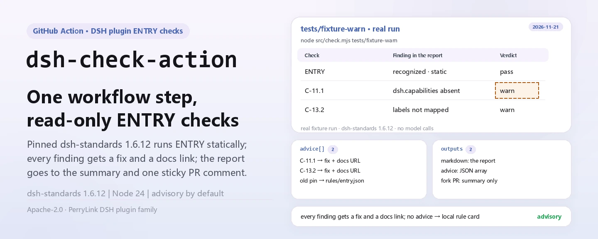
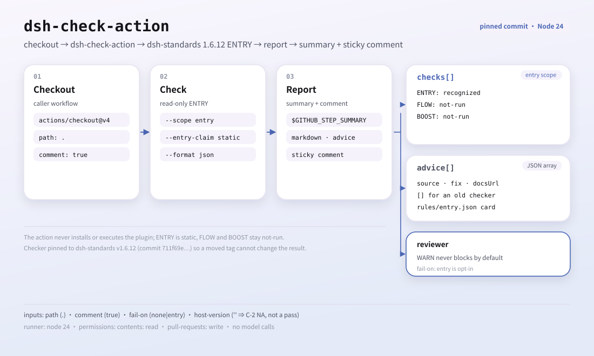
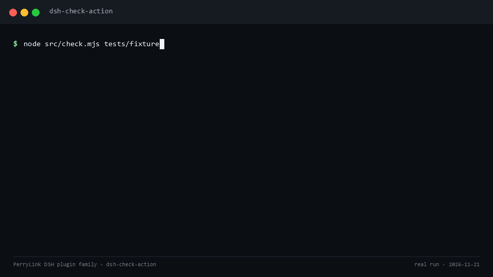

<div align="center">

<picture>
  <source media="(prefers-color-scheme: dark)" srcset="docs/assets/dsh-check-action-hero-en-dark.webp">
  
</picture>

# dsh-check-action

**DSH plugin के लिए केवल-पढ़ने वाली ENTRY जाँचें, नियतात्मक सुझावों के साथ — कोई मॉडल कॉल नहीं, इसलिए एक रन में कोई टोकन खर्च नहीं होता।**

*पिन किए गए `dsh-standards` checker के चारों ओर एक composite action: ENTRY को स्थिर रूप से चलाता है, उसके `advice[]` को markdown रिपोर्ट में बदलता है, उसे job summary में लिखता है और उसी रिपॉज़िटरी के PRs पर एक sticky टिप्पणी बनाए रखता है। fork PRs को केवल summary मिलती है।*

[English](README.md) · [简体中文](README-zh.md) · [Español](README-es.md) · [Português](README-pt.md) · हिन्दी

[](action.yml)
[]()
[](https://github.com/PerryLink/dsh-standards/blob/main/LICENSE)

</div>

---

```yaml
name: DSH check
on: [pull_request]
permissions:
  contents: read
  pull-requests: write
jobs:
  check:
    runs-on: ubuntu-latest
    steps:
      - uses: actions/checkout@v4
      - id: dsh
        uses: PerryLink/dsh-check-action@v1
        with:
          path: .
          comment: true
          fail-on: none   # advisory by default
          # host-version: 0.2.2-rc.3
```

## यह क्या करता है

1. DSH checker (`dsh-standards`, एक commit पर पिन किया गया) को स्थिर ENTRY मोड में चलाता है।
2. उसका अतिरिक्त `advice[]` पढ़ता है (1.2 रिलीज़ और बाद के संस्करण): हर निष्कर्ष के लिए
   एक सुधार और एक गाइड URL। अगर checker के पास `advice` नहीं है (पुराना pin), तो वह
   अंतर्निहित `rules/entry.json` कार्डों पर लौट आता है — कोई त्रुटि नहीं, वही सलाह आउटपुट।
3. रिपोर्ट को job summary में लिखता है और उसे `markdown` आउटपुट के रूप में देता है।
   checker की कच्ची `advice[]` प्रविष्टियाँ `advice` आउटपुट के रूप में दी जाती हैं
   (एक JSON array; जब पिन किया गया checker advice नहीं देता तो `[]`)।
4. उसी रिपॉज़िटरी के pull requests पर यह एक sticky टिप्पणी पोस्ट या अपडेट करता है।
   **fork pull requests को केवल job summary मिलती है**: वहाँ token केवल-पढ़ने वाला है,
   इसलिए टिप्पणी चरण विफल होने के बजाय छोड़ दिया जाता है।


<picture>
  <source media="(prefers-color-scheme: dark)" srcset="docs/assets/dsh-check-action-flow-v5-dark.svg">
  
</picture>

*संरचना: checkout → check → publish; checker स्थिर ENTRY है और केवल पढ़ता है, इसलिए FLOW और BOOST `not-run` रहते हैं। आरेख के भीतर केवल असली action inputs, checker flags और आउटपुट नाम हैं, इसलिए एक ही चित्र पाँचों भाषाओं के लिए काम आता है।*

## इनपुट

| इनपुट | डिफ़ॉल्ट | अर्थ |
|---|---|---|
| `path` | `.` | रिपॉज़िटरी के भीतर plugin पैकेज का path। |
| `comment` | `true` | sticky pull-request टिप्पणी पोस्ट या अपडेट करें (केवल उसी रिपॉज़िटरी के PRs)। |
| `fail-on` | `none` | `none` रन को सलाह के रूप में रखता है; `entry` किसी कठोर ENTRY विफलता पर job विफल करता है। |
| `host-version` | `''` | वैकल्पिक dsh संस्करण जो host चलाता है, C-2 एंकर के लिए। खाली ⇒ C-2 NA है, पास नहीं। |

### `host-version`

वैकल्पिक। यह C-2 (`engines.dsh`) एंकर के लिए इस्तेमाल होने वाला dsh संस्करण तय करता है।

**खाली होने का अर्थ है C-2 का निर्णय नहीं होता — वह NA है, पास नहीं।** action कोई host
इंस्टॉल नहीं करता, और GitHub-होस्टेड runner के PATH पर आमतौर पर `dsh` नहीं होता, इसलिए
checker की सर्वोत्तम-प्रयास `dsh --version` जाँच कुछ नहीं पाती और `DSC-02` को `NA`
(compatibility जाँची नहीं गई) के रूप में दर्ज करती है। इसलिए गलत `engines.dsh` रेंज
डिफ़ॉल्ट कॉन्फ़िगरेशन में रन को **विफल नहीं** करती, और `fail-on: entry` भी उसे नहीं पकड़ता।
जब आप compatibility का निर्णय चाहते हैं तो `host-version` (या `DSH_HOST_VERSION` environment
variable) सेट करें; मौजूदा लाइन के लिए `0.2.2-rc.3` इस्तेमाल करें (npm `next`; `latest` अभी भी `0.2.2-rc.1` है)।

पिन किए गए 1.6.12 checker में `--host-version` है। action checker का `--help` जाँचता है और मौजूद होने पर `--host-version` आगे भेजता है, वरना `--runtime-version` (वही एंकर पुराने नाम से)। अगर checker इनमें से कोई flag स्वीकार नहीं करता तो इनपुट अनदेखा किया जाता है, action लॉग में एक नोट छपता है, और checker की अपनी host जाँच (या fallback एंकर) लागू होती है।

## आउटपुट



*एनिमेटेड: 2026-11-21 पर असली `node src/check.mjs` stdout (checker dsh-standards 1.6.12 — वही संस्करण जो `action.yml` में पिन है), रिपॉज़िटरी के तीनों fixtures पर चलाया गया: साफ़, WARN और आरक्षित capability ids। रिपोर्ट का पाठ checker के चीनी टेम्पलेट से बनता है और उसे बदला नहीं गया है।*


| आउटपुट | अर्थ |
|---|---|
| `markdown` | रेंडर की गई markdown रिपोर्ट (वही पाठ जो job summary में लिखा जाता है)। |
| `advice` | checker का `advice[]` JSON array के रूप में; जब पिन किया गया checker advice देने के लिए बहुत पुराना हो तो `[]`। |

## यह क्या नहीं करता

- यह आपका plugin **इंस्टॉल या निष्पादित नहीं** करता। केवल ENTRY।
- जब तक आप `host-version` नहीं देते, यह `engines.dsh` compatibility का **निर्णय नहीं** करता:
  host संस्करण के बिना C-2 एंकर अज्ञात है और `DSC-02` `NA` है, पास नहीं।
- यह FLOW (journeys) या BOOST (evidence कार्ड) **नहीं** चलाता; वे `not-run` रहते हैं।
- यह **आधिकारिक नहीं** है, प्रमाणन नहीं है, और किसी की रैंकिंग नहीं करता।
- रिपोर्ट **सलाहकारी** है: WARN विफल नहीं होता, और `fail-on: none` (डिफ़ॉल्ट) कभी merge
  नहीं रोकता। `fail-on: entry` केवल कठोर ENTRY विफलता पर विफल होता है।

## पिनिंग

checker `PerryLink/dsh-standards` से एक पिन किए गए commit पर लिया जाता है
(`action.yml` में `DSH_CHECKER_REF`): **v1.6.12 /
`711f69e6347ed90b24d8a15f288c429d9042039d`**। पूरा commit इसलिए इस्तेमाल होता है कि हिलाया
गया tag परिणाम न बदल सके, और action **Node 24** पर चलता है।

1.6.12 rc3 host seams के लिए आरक्षित capability ids जोड़ता है
(`computer:control`, `mcp:manage`, `session-log:egress`, …): किसी एक को घोषित करना
स्वीकार्य है (कभी अज्ञात-id विफलता नहीं) और उसे not-run के रूप में रिपोर्ट किया जाता है,
over-declaration WARN के रूप में नहीं। selftest उस सतह को पिन करता है, इसलिए checker में
कोई regression या इस pin का downgrade workflow को विफल कर देता है।

action स्वयं एनोटेट किए गए `v1` tag से उपभोग होता है; पूरी तरह अपरिवर्तनीय संदर्भ चाहिए तो एक commit पिन करें।

## टूलचेन और upstream (तथ्य, 2026-11)

- यह Action डिफ़ॉल्ट रूप से पिन किए गए `dsh-standards` ENTRY checker को सलाहकारी मोड में चलाता है।
- Upstream: `dsh-plugin-hub` की main में संस्करण-जागरूक npm metadata जाँच है ([`4f3a560`](https://github.com/dshplugin/dsh-plugin-hub/commit/4f3a560), 2026-11-09); दायरा केवल install-समय npm metadata है; यह ENTRY नहीं चलाता और यह समर्थन नहीं है।
