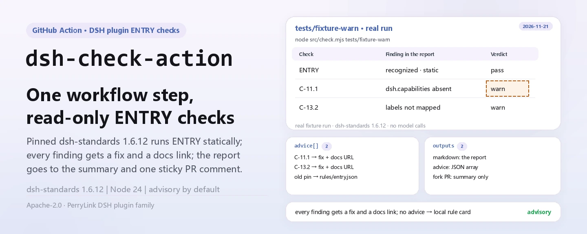
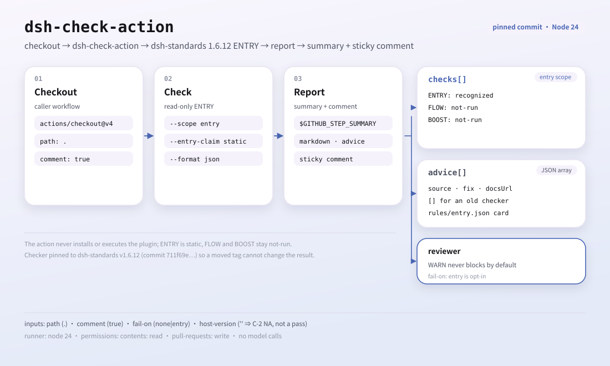
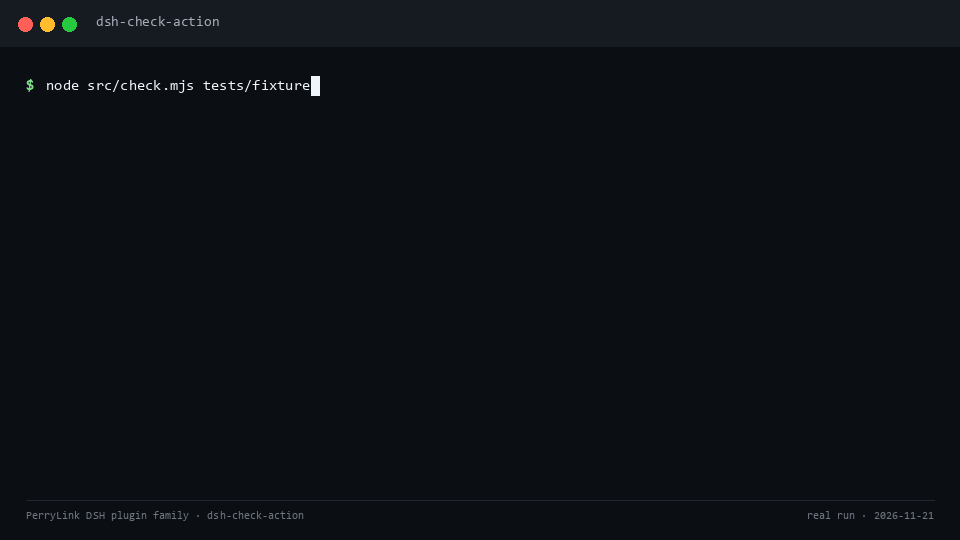

<div align="center">

<picture>
  <source media="(prefers-color-scheme: dark)" srcset="docs/assets/dsh-check-action-hero-en-dark.webp">
  
</picture>

# dsh-check-action

**Verificações ENTRY somente leitura para um plugin do DSH, com sugestões determinísticas — sem chamadas a modelos, então uma execução não custa tokens.**

*Uma composite action em torno do checker `dsh-standards` fixado: executa ENTRY de forma estática, transforma seu `advice[]` em um relatório markdown, grava-o no job summary e mantém um único comentário sticky nos PRs do mesmo repositório. PRs de fork recebem apenas o resumo.*

[English](README.md) · [简体中文](README-zh.md) · [Español](README-es.md) · Português · [हिन्दी](README-hi.md)

[](action.yml)
[]()
[](https://github.com/PerryLink/dsh-standards/blob/main/LICENSE)

</div>

---

```yaml
name: DSH check
on: [pull_request]
permissions:
  contents: read
  pull-requests: write
jobs:
  check:
    runs-on: ubuntu-latest
    steps:
      - uses: actions/checkout@v4
      - id: dsh
        uses: PerryLink/dsh-check-action@v1
        with:
          path: .
          comment: true
          fail-on: none   # advisory by default
          # host-version: 0.2.2-rc.3
```

## O que ele faz

1. Executa o checker do DSH (`dsh-standards`, fixado em um commit) no modo ENTRY estático.
2. Lê seu `advice[]` aditivo (a versão 1.2 e posteriores): uma correção e uma URL de guia
   por achado. Se o checker não tiver `advice` (um pin antigo), ele recorre aos cartões
   internos de `rules/entry.json` — sem erro, com a mesma saída de aconselhamento.
3. Grava o relatório no job summary e o expõe como a saída `markdown`.
   As entradas brutas `advice[]` do checker são expostas como a saída `advice`
   (um array JSON; `[]` quando o checker fixado não emite advice).
4. Em pull requests do mesmo repositório, publica ou atualiza um único comentário
   sticky. **Pull requests de fork recebem apenas o job summary**: ali o token é
   somente leitura, então a etapa de comentário é pulada em vez de falhar.


<picture>
  <source media="(prefers-color-scheme: dark)" srcset="docs/assets/dsh-check-action-flow-v5-dark.svg">
  
</picture>

*Estrutura: checkout → check → publish; o checker é ENTRY estático e somente leitura, então FLOW e BOOST ficam em `not-run`. Os rótulos dentro do diagrama são os inputs reais da action, as flags do checker e os nomes das saídas, então a mesma imagem serve aos cinco idiomas.*

## Entradas

| entrada | padrão | significado |
|---|---|---|
| `path` | `.` | Caminho do pacote do plugin dentro do repositório. |
| `comment` | `true` | Publica ou atualiza um comentário sticky do pull request (apenas PRs do mesmo repositório). |
| `fail-on` | `none` | `none` mantém a execução como aconselhamento; `entry` faz o job falhar em uma falha ENTRY dura. |
| `host-version` | `''` | Versão opcional do dsh que o host executa, usada para a âncora C-2. Sem valor ⇒ C-2 é NA, não aprovado. |

### `host-version`

Opcional. Define a versão do dsh usada para a âncora C-2 (`engines.dsh`).

**Sem valor significa que C-2 não é julgado — isso é NA, não aprovado.** A action não
instala um host, e um runner hospedado pelo GitHub normalmente não tem `dsh` no PATH, então
a sonda de melhor esforço `dsh --version` do checker não encontra nada e registra `DSC-02`
como `NA` (compatibilidade não julgada). Um intervalo `engines.dsh` errado, portanto, **não**
faz a execução falhar na configuração padrão, e `fail-on: entry` não pega isso.
Defina `host-version` (ou a variável de ambiente `DSH_HOST_VERSION`) quando quiser a
compatibilidade julgada; para a linha atual use `0.2.2-rc.3` (npm `next`; `latest` ainda é `0.2.2-rc.1`).

O checker 1.6.12 fixado tem `--host-version`. A action sonda o `--help` do checker e encaminha `--host-version` quando presente; caso contrário, `--runtime-version` (a mesma âncora com um nome mais antigo). Se o checker não aceitar nenhuma das flags, a entrada é ignorada, uma nota é impressa no log da action e a própria sonda de host do checker (ou a âncora de reserva) é aplicada.

## Saídas



*Animado: stdout real de `node src/check.mjs` em 2026-11-21 (checker dsh-standards 1.6.12 — a versão fixada em `action.yml`), executado contra os três fixtures do repositório: limpo, WARN e com ids de capacidade reservados. O texto do relatório é gerado pelos templates chineses do checker e não foi reescrito.*


| saída | significado |
|---|---|
| `markdown` | O relatório markdown renderizado (o mesmo texto gravado no job summary). |
| `advice` | O `advice[]` do checker como array JSON; `[]` quando o checker fixado é antigo demais para emitir advice. |

## O que ele não faz

- **Não** instala nem executa seu plugin. Apenas ENTRY.
- **Não** julga a compatibilidade de `engines.dsh` a menos que você passe `host-version`:
  sem versão de host a âncora C-2 é desconhecida e `DSC-02` é `NA`, não aprovado.
- **Não** executa FLOW (journeys) nem BOOST (cartões de evidência); esses ficam `not-run`.
- **Não** é oficial, não é uma certificação e não classifica nada.
- O relatório é **aconselhamento**: WARN não falha, e `fail-on: none` (o padrão) nunca
  bloqueia um merge. `fail-on: entry` só falha em uma falha ENTRY dura.

## Fixação de versão

O checker é baixado de `PerryLink/dsh-standards` em um commit fixado
(`DSH_CHECKER_REF` em `action.yml`): **v1.6.12 /
`711f69e6347ed90b24d8a15f288c429d9042039d`**. O commit completo é usado para que uma tag
movida não possa mudar o resultado, e a action roda em **Node 24**.

A 1.6.12 adiciona os ids de capacidade reservados para as costuras do host rc3
(`computer:control`, `mcp:manage`, `session-log:egress`, …): declarar um é aceito
(nunca uma falha por id desconhecido) e reportado como not-run, não como um WARN de
sobredeclaração. O selftest fixa essa superfície, então uma regressão no checker ou um
downgrade deste pin faz o workflow falhar.

A action em si é consumida pela tag anotada `v1`; fixe um commit se precisar de uma referência totalmente imutável.

## Ferramentas e upstream (fatos, 2026-11)

- Esta Action executa o checker ENTRY `dsh-standards` fixado em modo de aconselhamento por padrão.
- Upstream: a main do `dsh-plugin-hub` inclui uma verificação de metadados npm ciente de versão ([`4f3a560`](https://github.com/dshplugin/dsh-plugin-hub/commit/4f3a560), 2026-11-09); o escopo são apenas metadados npm no momento da instalação; ela não executa ENTRY e não é um endosso.
