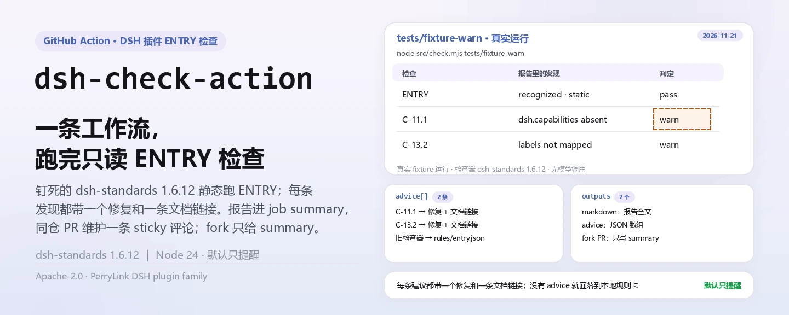
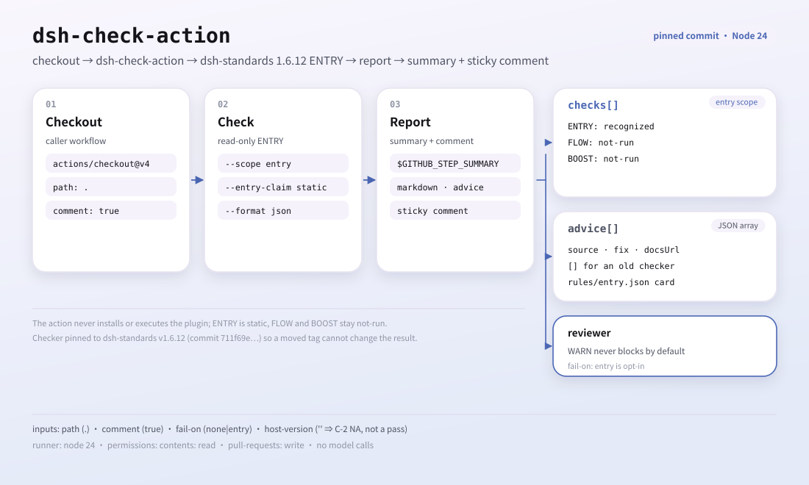
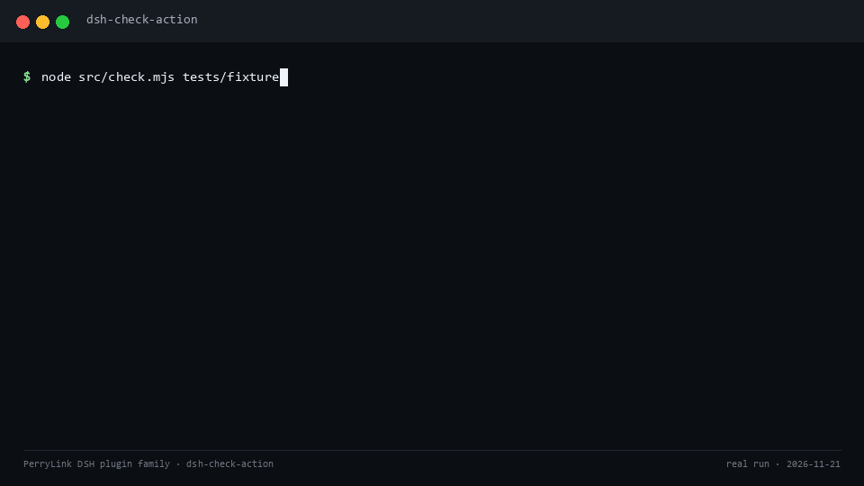

<div align="center">

<picture>
  <source media="(prefers-color-scheme: dark)" srcset="docs/assets/dsh-check-action-hero-zh-dark.webp">
  
</picture>

# dsh-check-action

**给 DSH 插件做只读 ENTRY 检查，并给出确定性的修改建议 —— 不调用模型，所以一次运行不花 token。**

*一个 composite action，包住钉死的 `dsh-standards` 检查器：静态跑 ENTRY，把 `advice[]` 渲染成 markdown 报告，写进 job summary，并在同仓 PR 上维护一条 sticky 评论。fork PR 只给 summary。*

[English](README.md) · 简体中文 · [Español](README-es.md) · [Português](README-pt.md) · [हिन्दी](README-hi.md)

[](action.yml)
[]()
[](https://github.com/PerryLink/dsh-standards/blob/main/LICENSE)

</div>

---

```yaml
name: DSH check
on: [pull_request]
permissions:
  contents: read
  pull-requests: write
jobs:
  check:
    runs-on: ubuntu-latest
    steps:
      - uses: actions/checkout@v4
      - id: dsh
        uses: PerryLink/dsh-check-action@v1
        with:
          path: .
          comment: true
          fail-on: none   # advisory by default
          # host-version: 0.2.2-rc.3
```

## 它做什么

1. 以静态 ENTRY 模式运行 DSH 检查器（`dsh-standards`，钉死到某个 commit）。
2. 读取它增量提供的 `advice[]`（1.2 及之后的版本）：每条发现给出一个修复和一个指南链接。
   如果检查器没有 `advice`（较旧的 pin），就回落到内置的 `rules/entry.json` 规则卡 ——
   不报错，输出的建议相同。
3. 把报告写进 job summary，并作为 `markdown` 输出暴露。检查器原始的 `advice[]` 条目
   作为 `advice` 输出暴露（一个 JSON 数组；钉死的检查器不产出 advice 时为 `[]`）。
4. 对于来自同一仓库的 pull request，它会发布或更新一条 sticky 评论。
   **fork 的 pull request 只写 job summary**：那里的 token 是只读的，所以评论步骤直接跳过而不是失败。


<picture>
  <source media="(prefers-color-scheme: dark)" srcset="docs/assets/dsh-check-action-flow-v5-dark.svg">
  
</picture>

*结构：检出 → 检查 → 发布；检查器是只读的静态 ENTRY，FLOW 与 BOOST 永远 `not-run`。图内只有真实的 action 输入、checker 参数与输出名，五语共用同一张结构图。*

## 输入

| 输入 | 默认值 | 含义 |
|---|---|---|
| `path` | `.` | 仓库内插件包的路径。 |
| `comment` | `true` | 发布或更新一条 sticky 的 pull-request 评论（仅同仓 PR）。 |
| `fail-on` | `none` | `none` 保持运行只提醒；`entry` 在 ENTRY 硬失败时让任务失败。 |
| `host-version` | `''` | 可选，宿主运行的 dsh 版本，用于 C-2 锚点。未设置 ⇒ C-2 为 NA，不是通过。 |

### `host-version`

可选。它设置 C-2（`engines.dsh`）锚点所用的 dsh 版本。

**不设置意味着 C-2 不被判定 —— 那是 NA，不是通过。** 这个 action 不会安装宿主，
而 GitHub 托管的 runner 通常 PATH 上没有 `dsh`，所以检查器尽力执行的 `dsh --version`
探测什么也找不到，把 `DSC-02` 记为 `NA`（兼容性未判定）。因此错误的 `engines.dsh`
范围在默认配置下**不会**让这次运行失败，`fail-on: entry` 也抓不到它。想让兼容性被判定时，
请设置 `host-version`（或 `DSH_HOST_VERSION` 环境变量）；当前这条线用 `0.2.2-rc.3`
（npm 的 `next`；`latest` 仍是 `0.2.2-rc.1`）。

钉死的 1.6.12 检查器有 `--host-version`。action 会探测检查器的 `--help`：有该参数就转 `--host-version`，
否则转 `--runtime-version`（同一个锚点的旧名字）。如果两个参数都不接受，这个输入会被忽略，
action 日志里打印一条说明，然后按检查器自己的宿主探测（或回退锚点）处理。

## 输出



*动图是 2026-11-21 在本检出里真实运行 `node src/check.mjs` 的输出（检查器为 dsh-standards 1.6.12，即 `action.yml` 钉死的版本），依次跑三个仓库自带 fixture：干净、带 WARN、带保留能力 ID。报告文本由检查器的中文模板渲染，未做改写。*


| 输出 | 含义 |
|---|---|
| `markdown` | 渲染好的 markdown 报告（与写进 job summary 的文本相同）。 |
| `advice` | 检查器的 `advice[]`，JSON 数组；钉死的检查器太旧、不产出 advice 时为 `[]`。 |

## 它不做什么

- 它**不**安装或执行你的插件。只做 ENTRY。
- 除非你传 `host-version`，它**不**判定 `engines.dsh` 兼容性：没有宿主版本时 C-2 锚点未知，
  `DSC-02` 是 `NA`，不是通过。
- 它**不**跑 FLOW（journeys）或 BOOST（证据卡）；那些保持 `not-run`。
- 它**不是**官方，不是认证，也不做任何排名。
- 报告是**提醒**性质：WARN 不会失败，`fail-on: none`（默认）永远不会阻断合并。
  `fail-on: entry` 只在 ENTRY 硬失败时失败。

## 钉版

检查器从 `PerryLink/dsh-standards` 按钉死的 commit 拉取（`action.yml` 里的 `DSH_CHECKER_REF`）：
**v1.6.12 / `711f69e6347ed90b24d8a15f288c429d9042039d`**。用的是完整 commit，
这样移动过的 tag 无法改变结果；action 运行在 **Node 24** 上。

1.6.12 增加了 rc3 宿主接缝的保留能力 ID（`computer:control`、`mcp:manage`、`session-log:egress`、…）：
声明其中一个是可接受的（绝不作为未知 ID 失败），并记为 not-run，而不是过度声明的 WARN。
selftest 钉住了这个表面，所以检查器回归或这个 pin 被降级都会让工作流失败。

action 本身通过带注释的 `v1` tag 使用；需要完全不可变的引用就钉 commit。

## 工具链与上游（事实，2026-11）

- 这个 Action 默认以提醒模式运行钉死的 `dsh-standards` ENTRY 检查器。
- 上游：`dsh-plugin-hub` 的 main 包含一个版本感知的 npm 元数据检查（[`4f3a560`](https://github.com/dshplugin/dsh-plugin-hub/commit/4f3a560)，2026-11-09）；范围仅限安装期的 npm 元数据；它不跑 ENTRY，也不构成本 Action 的背书。
